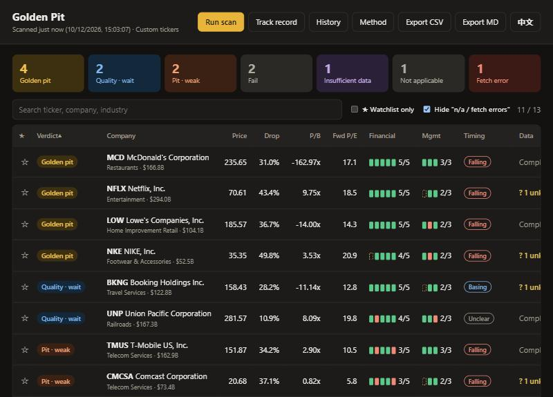
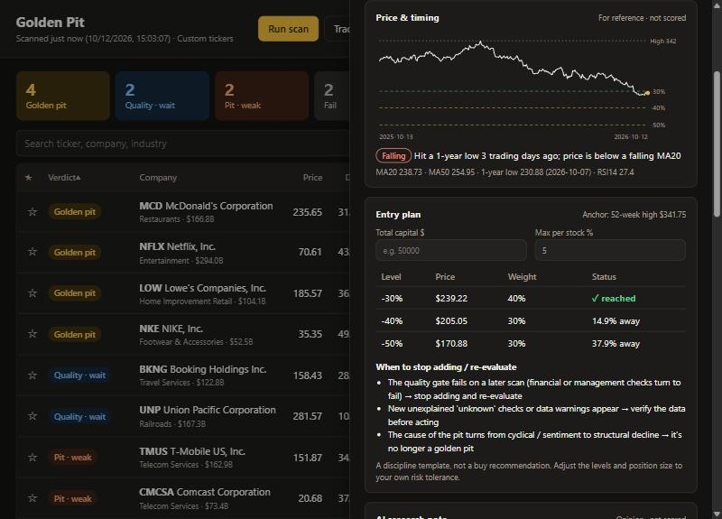
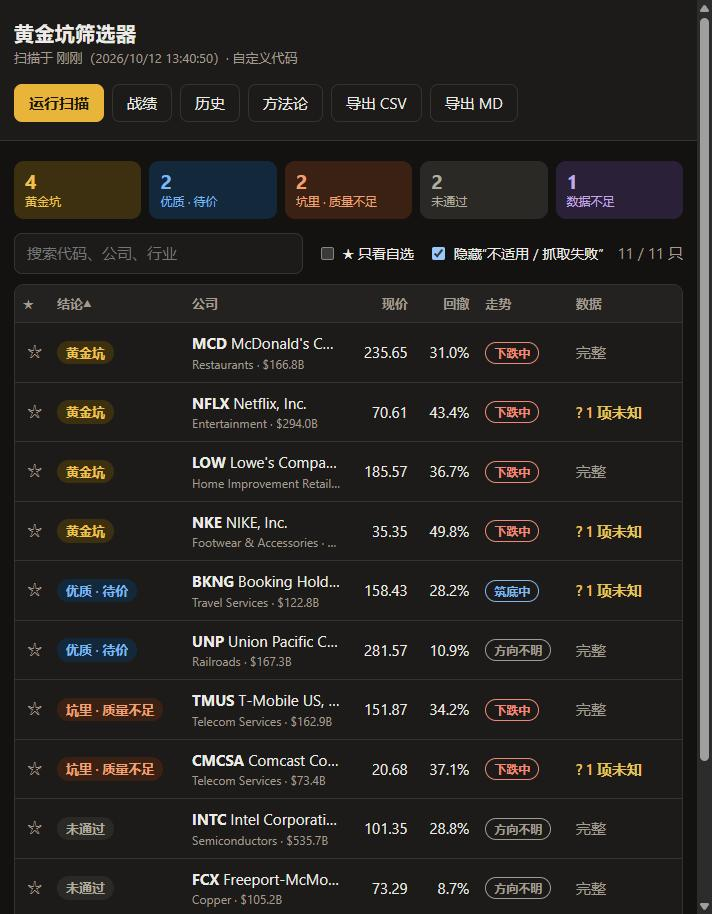
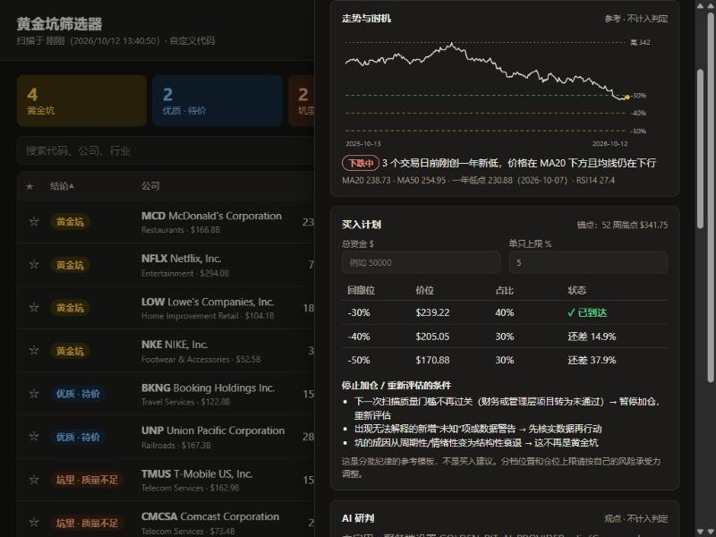

# Golden Pit 黄金坑

**Find quality US stocks that are *genuinely* in a price pit — and be honest about what the data can't tell you.**
**找出真正跌进坑里的好公司——并且诚实地告诉你，哪些是数据说不清的。**

[English](#english) · [中文](#中文)



---

## English

### Why another screener?

Most "buy the dip" screeners add everything into one score. That's how a great company trading at its all-time high ends up labelled a "strong buy": quality points alone clear the bar. Golden Pit asks **two separate questions**, and a stock is a *golden pit* only when both are yes:

| Question | Rule (defaults, all configurable) |
|---|---|
| **① Is the business healthy?** (quality gate) | Financial 5 checks, ≥4 pass: interest coverage ≥2x · current ratio ≥1 · net debt/EBITDA ≤5x · FCF >0 · Altman Z ≥1.8<br>Management 3 checks, ≥2 pass: share count down ≥1% · net buyback yield ≥1% · capex/revenue ≤15% |
| **② Is the price really in a pit?** (pit condition) | ≥30% below 52-week high (required) **and** P/B ∈ (0, 2] or forward P/E ∈ (0, 25] |

Verdicts: **Golden pit** · Quality, wait for price · In a pit but weak (value-trap risk) · Fail · Insufficient data · Not applicable (financials) · Fetch error.

### Data integrity rules

Free market data is messy. Golden Pit refuses to guess:

- **Missing data is `unknown`, never a pass and never zero.** Too many unknowns → "insufficient data", no verdict.
- **Loss-makers can't pass interest coverage.** No `abs()` on negative EBIT.
- **Currency mismatches are detected.** For example, ADRs that report in JPY but quote in USD: market-cap-based ratios become `unknown`, not a nonsense 368% buyback yield.
- **A stock split inside the window marks the share-count change `unknown`.**
- **Dividend yield is computed from `dividendRate / price`.** Yahoo's `dividendYield` field changed units between versions.
- **A failed price fetch never falls back to a stale cached price.** Every number shows when it was fetched.

### What you get

- **Universes**: the Yahoo live screener of beaten-down stocks, all S&P 500 members, an 82-stock curated high-moat pool, your watchlist, or any tickers you type.
- **Web app** with a sortable table, verdict reasons, all 11 checks with value, rule and note, watchlist ★, CSV/Markdown export and scan history.
- **Timing layer** (falling / basing / rebounding) and a 1-year price chart with staged entry levels. It answers *"has it stopped falling?"* and does not change the verdict.
- **Entry planner**: −30% / −40% / −50% tranches from the 52-week high, sized from your own capital and position cap. It is a discipline template, not advice.
- **Forward track record.** Every golden-pit call is logged with its price and compared to SPY going forward. This replaces a backtest: free data has no point-in-time fundamentals, so a backtest would be look-ahead-biased.
- **Optional AI research notes** via Command Code CLI or any OpenAI-compatible API. The model sees only our computed snapshot, output is schema-validated, and notes are labelled *opinion, not part of the verdict*.
- **CLI and MCP server**, so Claude Code and other agents can call it directly.
- **Bilingual (English / 中文)** everywhere: web UI with a language toggle, CLI (`--lang`), API (`?lang=`), MCP, exports and AI notes.
- **Disk cache.** Rescans take seconds instead of minutes.



### Quick start

```bash
pip install "golden-pit[mcp] @ git+https://github.com/jwan2/golden-pit.git"
golden-pit serve                 # → http://127.0.0.1:5000
golden-pit scan MCD NKE BKNG     # terminal table
golden-pit scan --mode sp500     # all ~500 S&P 500 members (first run is slow, then cached)
golden-pit universe update       # refresh the S&P 500 constituent list
golden-pit analyze MCD           # full reasoning for one stock
golden-pit track                 # forward track record
claude mcp add golden-pit -- golden-pit mcp   # use from Claude Code
```

Data lives in `~/.golden-pit`. You can override it with `GOLDEN_PIT_DATA`. Thresholds can be overridden in `~/.golden-pit/settings.json`, e.g. `{"thresholds": {"pb_max": 3}}`.

### Configuration

| Env var | Meaning |
|---|---|
| `GOLDEN_PIT_ADMIN_TOKEN` | Required for scans/AI when not on localhost (header `X-Admin-Token`). Without it, only localhost may trigger actions. |
| `GOLDEN_PIT_LANG` | `en` or `zh` — default language for the CLI, MCP and API (the web app follows the browser and has a toggle) |
| `GOLDEN_PIT_HOST` / `GOLDEN_PIT_PORT` | Default `127.0.0.1:5000` |
| `GOLDEN_PIT_DATA` | Data directory (default `~/.golden-pit`) |
| `GOLDEN_PIT_SCHEDULER=1`, `GOLDEN_PIT_SLOTS` | Auto-scan on US weekdays, default `08:30,16:15` ET |
| `GOLDEN_PIT_SCHEDULED_MODE` | Universe for scheduled scans: `live` (default), `sp500` or `curated` |
| `GOLDEN_PIT_QUOTE_TTL`, `GOLDEN_PIT_FUNDAMENTALS_TTL` | Cache lifetimes in seconds (default 1 h / 7 days) |
| `GOLDEN_PIT_AI_PROVIDER` | `none` · `cli` (Command Code) · `openai` (any compatible API) |
| `GOLDEN_PIT_AI_MODEL`, `_BASE_URL`, `_KEY`, `_AUTO_TOP` | AI settings; `_AUTO_TOP=5` auto-reviews the top 5 after each scan |

### Self-hosting

```bash
docker compose up -d     # binds 127.0.0.1:5000; put HTTPS (Caddy/Nginx) in front
```

Use a single worker. Scan state and the scheduler live in-process.

### Limitations, honestly

- Data comes from Yahoo Finance via `yfinance`. It is unofficial, may be delayed or wrong, and is **for personal research only**. This project does not ship or redistribute any market data.
- Altman Z uses the classic manufacturing model and understates asset-light firms. The UI says so.
- The industry "moat" notes are human opinions at industry level. They are shown, never scored.
- The track record needs months and dozens of samples before it means anything. The UI says so.

**Not investment advice.** See [LICENSE](LICENSE) (MIT).

---

## 中文

### 它解决什么问题

大多数"抄底"筛选器把所有指标加成一个总分，结果一只就在历史高点的好公司也能被标成"强烈买入"。黄金坑把问题拆成两个，**两个都满足才算黄金坑**：

- **① 质量门槛**：财务 5 项至少过 4 项，管理层 3 项至少过 2 项
- **② 坑位条件**：距 52 周高点回撤 ≥30%（必需），且 P/B 或前瞻市盈率至少一项合格

结论分为：黄金坑 · 优质待价 · 坑里但质量不足（价值陷阱风险）· 未通过 · 数据不足 · 不适用（金融业）· 抓取失败。

### 数据诚信规则

- **缺失数据一律"未知"**：不算通过，也不当 0；未知项太多就是"数据不足"，不下结论
- **亏损公司不能通过利息保障**：不对负 EBIT 取绝对值
- **识别币种不一致**：例如日元财报、美元报价的 ADR，依赖市值的指标标为未知
- **拆股窗口**：期间内有拆股，股本变化标为未知
- **股息率**：用 `dividendRate / price` 计算，避开 yfinance 不同版本的单位差异
- **不用旧价格冒充现价**：行情抓取失败时绝不回退到旧缓存；每个数字都标注抓取时间

### 功能

- **候选池**：Yahoo 实时筛选（跌深的股票）、S&P 500 全部成分股、82 只高壁垒核心池、你的自选，或任意代码
- **网页**：可排序表格、结论理由、11 项指标逐条（值 / 要求 / 备注）、★ 自选、CSV / Markdown 导出、历史回看





- **走势时机**：标出下跌中 / 筑底中 / 企稳反弹，并画一年价格图和分批价位线。回答"跌完了吗"，不改变判定
- **买入计划器**：以 52 周高点为锚分三档；输入你的资金和单只上限，换算金额和股数。是纪律模板，不是建议
- **战绩追踪**：每次判为黄金坑都记录价格，之后持续与 SPY 对比。免费数据没有历史时点财报，回测会有前视偏差，所以用前向记录代替
- **AI 研判（可选）**：支持 Command Code CLI 或任意 OpenAI 兼容接口。模型只能看我们算好的快照，输出逐字段校验，标注"观点·不计入判定"
- **命令行和 MCP server**：Claude Code 等 AI 客户端可直接调用
- **中英双语**：网页（右上角一键切换）、命令行（`--lang zh`）、接口（`?lang=zh`）、MCP、导出和 AI 研判都支持
- **本地缓存**：重复扫描从几分钟降到几秒

### 快速开始

见上方 [Quick start](#quick-start)，命令相同。数据默认存放在 `~/.golden-pit`。

### 局限

- 数据来自 Yahoo Finance（经 yfinance），非官方，可能延迟或出错，**仅供个人研究**。本项目不提供、不分发任何行情数据。
- Altman Z 用的是经典制造业版本，会低估轻资产公司。
- 行业护城河观点是行业级的人工观点，只展示，不计分。
- 战绩追踪需要数月时间和几十个样本才有意义。

**不构成投资建议。** 许可证：[MIT](LICENSE)。
